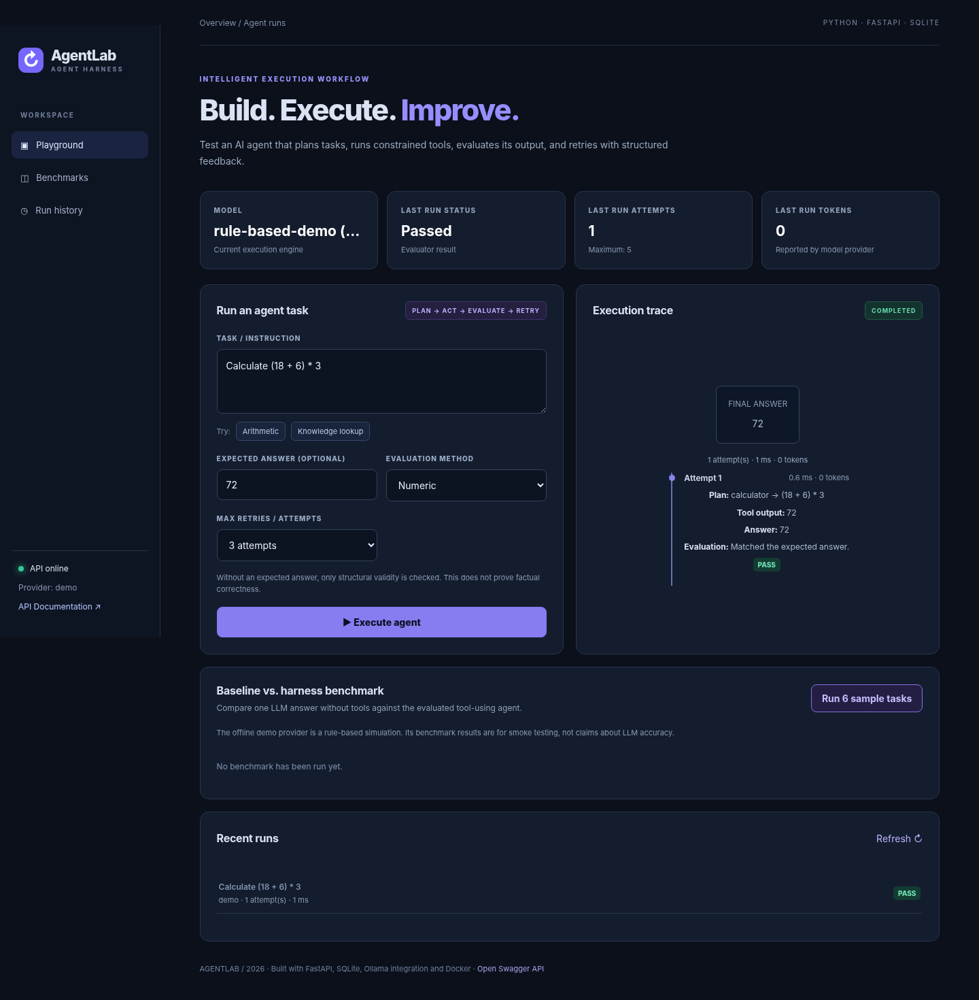
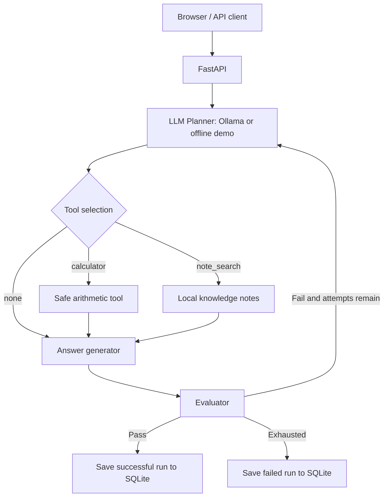

# Self-Improving AI Agent Harness

A runnable, testable **agent orchestration + evaluation MVP** built with **Python, FastAPI, SQLite, Docker, and optional local Ollama LLMs**. It includes a browser dashboard, execution traces, bounded retries, and a baseline comparison that you can reproduce.\n\n**Status:** The complete offline workflow is implemented and covered by tests. The Ollama integration is implemented but requires a running local model to verify end to end; Docker deployment must be verified on a Docker-enabled machine.

The agent follows a bounded cycle:

1. **Plan:** Choose a safe tool (calculator, local-note search, or no tool).
2. **Execute:** Run the selected tool; no shell commands or arbitrary Python execution.
3. **Answer:** Generate a response using the tool result.
4. **Evaluate:** Compare the response with known ground truth, or perform a basic structural check if none was given.
5. **Improve next attempt:** On failure, send evaluation feedback to the planner and try again (up to 5 attempts).

> **Important:** "Self-improving" means **feedback-driven correction within a task run**. The model's weights are **not** retrained and it does not permanently learn between runs.

## Interface

A browser-based dashboard lets you execute tasks, inspect each plan/tool/evaluation step, benchmark the harness, and view recent SQLite history.

  \n\n\n\n*Dashboard preview showing a real offline-demo response from the FastAPI app. It is not an Ollama execution or evidence of LLM improvement.*

**Local app:** `http://127.0.0.1:8000`  
**Interactive API docs:** `http://127.0.0.1:8000/docs`

## Architecture



## Quick start (Windows / PowerShell)

From the extracted project folder:

```powershell
python -m venv .venv
.\.venv\Scripts\python.exe -m pip install -r requirements-dev.txt
.\.venv\Scripts\python.exe -m uvicorn app.main:app --reload
```

Open **http://127.0.0.1:8000**. The default **demo** provider requires **no API key, Ollama installation, or external internet service**. It only handles simple arithmetic and a handful of facts in `data/notes.json`. It is **not an LLM**.

Run unit tests in another terminal:

```powershell
.\.venv\Scripts\python.exe -m pytest -q
```

### macOS / Linux

```bash
python3 -m venv .venv
source .venv/bin/activate
python -m pip install -r requirements-dev.txt
python -m uvicorn app.main:app --reload
```

## Use a real local LLM with Ollama

1. Install [Ollama](https://ollama.com/) and start the Ollama application/service.
2. Download a model: `ollama pull llama3.2:3b`.
3. Set the provider, then start FastAPI:

**Windows PowerShell:**

```powershell
$env:LLM_PROVIDER = "ollama"
$env:OLLAMA_MODEL = "llama3.2:3b"
.\.venv\Scripts\python.exe -m uvicorn app.main:app --reload
```

**macOS / Linux:**

```bash
export LLM_PROVIDER=ollama
export OLLAMA_MODEL=llama3.2:3b
python -m uvicorn app.main:app --reload
```

If Ollama is installed but not running, start its local service with `ollama serve` (only if no Ollama service is already active).

The real LLM is used **both for planning and answer generation**. Responses from smaller models may not always follow JSON or pick the right tool, so the harness validates plans and uses feedback to retry. No external paid API is required. The local model consumes system memory and takes longer than the demo provider.

## Docker

**Offline demo:**

```bash
docker compose up --build
```

For a **containerized local Ollama**, create `.env` from `.env.example`, set `LLM_PROVIDER=ollama` and `OLLAMA_URL=http://ollama:11434`, then run:

```bash
docker compose --profile llm up -d --build
docker compose exec ollama ollama pull llama3.2:3b
```

Once the model is downloaded, open **http://127.0.0.1:8000**. The `ollama` service is optional via a Docker Compose profile; model files and SQLite run data are stored in named volumes.

> Docker model downloads can be large; `llama3.2:3b` is a multi-GB model. CPU inference may be slow.

## API endpoints

| Method | Endpoint | Purpose |
| --- | --- | --- |
| `GET` | `/` | Browser dashboard |
| `GET` | `/health` | Server and provider status |
| `POST` | `/agent/run` | Execute a task using plan → tool → evaluate → retry |
| `POST` | `/benchmark/run` | Compare direct-answer baseline vs. evaluated harness |
| `GET` | `/runs?limit=15` | Recent SQLite run summaries |
| `GET` | `/runs/{run_id}` | Full stored execution trace |
| `GET` | `/docs` | Swagger/OpenAPI documentation |

**Sample task request** (PowerShell works with `Invoke-RestMethod`):

```powershell
$body = @{
    task = "Calculate (18 + 6) * 3"
    expected_answer = "72"
    match_type = "numeric"
    max_attempts = 3
} | ConvertTo-Json

Invoke-RestMethod -Uri "http://127.0.0.1:8000/agent/run" -Method Post -ContentType "application/json" -Body $body
```

Or send the equivalent JSON to `POST /agent/run` in `/docs`:

```json
{
  "task": "Calculate (18 + 6) * 3",
  "expected_answer": "72",
  "match_type": "numeric",
  "max_attempts": 3
}
```

If `expected_answer` is left out, the evaluator checks only for a nonempty, structurally acceptable answer and whether the selected tool failed. It **cannot claim that an open-ended answer is factually correct** without a reference answer.

**Benchmark request:**

```json
{ "limit": 6, "max_attempts": 3 }
```

## How benchmarking works

The benchmark uses `data/benchmark.json` with 6 sample tasks (arithmetic and knowledge lookup).

- **Baseline:** One direct provider response, with **no tools, evaluator feedback, or retries**.
- **Harness:** Planner + tools + answer generator + evaluation; limited retries on failed attempts.
- **Metrics:** Exact/contains/numeric task success rate; wall-clock latency (milliseconds); provider-reported token usage, and attempt counts.
- **Ground truth:** Stored expected answers are used only by the evaluator, **not** inserted into LLM prompts. The benchmark tasks and answers are visible locally in the repo, so this is an illustration rather than a blind or statistically reliable evaluation.
- **Demo limitation:** The offline rule-based demo baseline intentionally does not answer questions without tools. Its comparison is only a **functional smoke test** and **must not** be used as evidence of AI performance gains.
- **Ollama metrics:** Reported token usage is the sum of Ollama's `prompt_eval_count` and `eval_count`. Calls can vary across hardware and model versions, so record your actual environment for credible measurements.

For a meaningful model evaluation, expand the benchmark, keep separate held-out tasks, run both strategies multiple times, and report confidence intervals and failure types. **No real-LLM benchmark results are claimed in this repository.**

### Export reproducible benchmark evidence

In a **second terminal** in the project folder, while the app is running or stopped:

```powershell
.\.venv\Scripts\python.exe -m scripts.benchmark_cli --provider demo --output reports/demo.json
```

After configuring and starting **Ollama** locally:

```powershell
.\.venv\Scripts\python.exe -m scripts.benchmark_cli --provider ollama --output reports/ollama.json
```

Reports contain the provider/model, environment metadata, per-task outcomes, token counts, and timing. The `demo` report explicitly flags itself as a smoke test. Never label demo-only results as real-LLM improvements.

See **[Verification and reviewer checklist](docs/VERIFICATION.md)** before publishing performance claims.


## Project structure

```text
self-improving-ai-agent-harness/
├── app/
│   ├── main.py           # FastAPI routes and app factory
│   ├── harness.py        # Bounded planning/evaluation/retry loop
│   ├── providers.py      # Ollama and offline demo providers
│   ├── tools.py          # AST-safe calculator, local note search
│   ├── evaluation.py     # Numeric / exact / contains scoring
│   ├── benchmark.py      # Baseline-vs-harness measurements
│   ├── storage.py        # SQLite run and attempt storage
│   ├── config.py         # Environment configuration
│   └── schemas.py        # Pydantic request and result types
├── data/
│   ├── notes.json        # Local searchable facts
│   └── benchmark.json    # Sample labeled tasks
├── static/               # Browser dashboard (HTML, CSS, JS)
├── tests/                # Unit, integration, and provider tests\n├── scripts/              # Export benchmark reports from the command line\n├── docs/                 # Dashboard preview and verification checklist
├── .github/workflows/ci.yml
├── Dockerfile
├── compose.yaml
├── requirements.txt
└── README.md
```

## Tests

```bash
python -m pytest -q
```

Includes calculator security checks, note-search tests, simulated wrong answers corrected on retry, invalid-plan recovery, SQLite persistence, API integration, benchmark export, and Ollama request formatting. CI runs pytest on Python 3.11 and 3.12.

## Security and limitations

- Intended as a **local demo/research MVP**, **not a production-hosted autonomous agent**. There is **no authentication, request quota, job queue, or multi-user isolation**. Do not expose it directly on the public internet.
- The planner can only select predefined tools. The calculator uses an AST allowlist; this agent **cannot run arbitrary commands** or edit the host filesystem.
- The knowledge base is only a tiny local JSON file, not general internet search or vector RAG.
- No persistent memory is fed back to the LLM; SQLite provides an audit trail, not online learning.
- If a wrong expected answer is provided, evaluation may incorrectly reject a correct answer. Numeric scoring uses an absolute tolerance of `1e-6`.
- Retry feedback is not guaranteed to lead to improvement. Plan failures, model hallucinations and unhelpful retries remain possible.
- The synchronous API makes model calls within the HTTP request; a background task queue is a sensible future improvement.

## GitHub upload (after creating an empty repository)

Create an **empty** GitHub repo named `self-improving-ai-agent-harness` (do not initialize with a README), then from the project folder:

```bash
git init
git add .
git commit -m "Build self-improving AI agent harness MVP"
git branch -M main
git remote add origin https://github.com/YOUR_USERNAME/self-improving-ai-agent-harness.git
git push -u origin main
```

Replace `YOUR_USERNAME`. GitHub authentication may require browser login or a personal access token; do not paste secrets into this repo.

## License

MIT — see [LICENSE](LICENSE).
